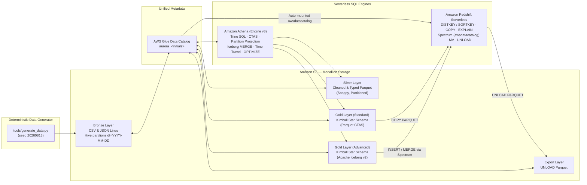

# AWS Lakehouse & Data Warehouse Workshop — S3, Glue, Athena, Apache Iceberg & Redshift Serverless

[](.github/workflows/verify.yml)


Hands-on **3-day data engineering workshop** (`3 × 3h` lab modules, offered in **Standard** and **Advanced** tracks) covering modern **Medallion Data Lake**, **Kimball Dimensional Data Warehouse**, and **Apache Iceberg Lakehouse** architectures on AWS — executed entirely in the AWS Management Console (`eu-central-1`) without local clusters, Docker containers, or external orchestrators.

All exercises operate on **Aurora**, a deterministic synthetic Polish e-commerce dataset generated from code (`tools/generate_data.py`), with every query count, byte scan, execution plan, and financial reconciliation (`1 427 124.00 PLN` baseline + `101 546.00 PLN` increment = `1 528 670.00 PLN`) cross-checked by an automated Python verification suite.

---

## Architecture Overview



---

## Curriculum & Track Matrix

Day 1 establishes a shared Medallion foundation on Amazon S3 and Amazon Athena. Days 2 and 3 provide two complete implementations over the exact same source data and control totals:

| Module | Folder | Core Engineering Topics | Key SQL & AWS Capabilities |
|---|---|---|---|
| **Day 1 — Data Lakes** *(Shared)* | `Data_Lakes_i_Data_Warehouses/Dzien1_Data_Lakes/` | Medallion **Bronze → Silver**, schema-on-read over CSV (`OpenCSVSerde`) & clickstream JSON Lines (`JsonSerDe`), Hive partitioning (`MSCK REPAIR TABLE`), columnar Snappy Parquet via `CTAS`, cost/scan benchmarking (`24 119 B` → `940 B`), Partition Projection, `$path` & bucketing | Amazon S3, AWS Glue Data Catalog, Amazon Athena v3, Parquet, Apache Iceberg intro (`S1`) |
| **Day 2 — Data Warehouse** *(Standard)* | `Data_Lakes_i_Data_Warehouses/Dzien2_Data_Warehouse/` | **Kimball Star Schema** (`dim_date`, `dim_customer`, `dim_product`, `dim_channel`, `fact_order_item`), explicit grain & surrogate keys, Athena ELT, cross-engine catalog addressing (`awsdatacatalog`), native warehouse loading & 3-layer IAM/DB permission diagnostics | Athena `CTAS`, Redshift Serverless, Redshift Spectrum, `COPY ... FORMAT AS PARQUET` |
| **Day 2 — Data Warehouse** *(Advanced)* | `Data_Lakes_i_Data_Warehouses/Dzien2_Data_Warehouse_Zaawansowany/` | Enterprise Kimball bus matrix: **role-playing date dimension** (365-day calendar + `-1` unknown member), **junk dimension** (`status × channel`), **accumulating snapshot fact** (`dw_fact_order_fulfillment`), daily sales aggregate, SQL data-quality assertion suite, `ROLLUP`/`CUBE`/window analytics, physical design & query plan inspection | Apache Iceberg (`table_type='ICEBERG'`), Redshift `DISTSTYLE ALL`/`DISTKEY`/`SORTKEY`, `EXPLAIN`, Materialized Views, `UNLOAD` round-trip |
| **Day 3 — SCD2 & Lakehouse** *(Standard)* | `Data_Lakes_i_Data_Warehouses/Dzien3_Data_Warehouse/` | **Slowly Changing Dimension Type 2** (`valid_from`, `valid_to`, `is_current`), watermark-based incremental fact loading (`2026-01-20`), immutable Parquet vs. Iceberg `MERGE` comparison, federated Lakehouse funnel join (`bronze_events` JSON + `gold_fact_order_item`), *as-was* vs. *as-is* revenue attribution, cloud teardown | Athena views & `UNION ALL` SCD2, Iceberg `MERGE INTO`, Redshift Spectrum |
| **Day 3 — SCD2 & Lakehouse** *(Advanced)* | `Data_Lakes_i_Data_Warehouses/Dzien3_Data_Warehouse_Zaawansowany/` | In-place **ACID SCD Type 2** (`MERGE` + `INSERT`), composite-key incremental `MERGE` idempotency, late-arriving fulfillment updates, **Iceberg Time Travel** (`FOR VERSION AS OF`), metadata tables (`$snapshots`, `$files`, `$manifests`, `$partitions`), schema evolution, bin-pack compaction & snapshot expiration, Redshift `MERGE` & `SYS_SERVERLESS_USAGE` RPU cost audit | Iceberg `MERGE`, `OPTIMIZE ... REWRITE DATA USING BIN_PACK`, `VACUUM`, Redshift `MERGE` & `REFRESH MATERIALIZED VIEW` |

---

## Engineering Tooling & Quality Gates

Unlike static slideware, this repository treats workshop materials as tested software artifacts:

- **Deterministic Synthetic E-Commerce Generator (`tools/generate_data.py`)** — Generates the complete multi-day **Aurora** dataset (customers, products, partitioned orders, order items, non-converting + converting JSONL clickstream sessions, SCD2 customer moves, and in-transit/late-arriving parcel shipments) directly in target S3 prefix directory trees using fixed PRNG seeds (`20260813`, `20260814`, `20260903`).
- **Control-Value Reference Engine (`tools/expected_results.py`)** — Recomputes every exercise metric in pure Python `Decimal` arithmetic to guarantee 1:1 parity with SQL solutions across Athena and Redshift.
- **Offline Split-Pane Lab Viewer Builder (`tools/build_sala_html.py`)** — Compiles each module's `01_zadania.md`, `02_rozwiazania.md`, and `sql/*.sql` scripts into a zero-dependency, offline `file://` dual-pane HTML application (`sala.html`) with synchronized exercise navigation, custom offline Athena/Redshift SQL syntax highlighting, one-click SQL copy buttons, and `sessionStorage` scroll persistence.
- **Automated Audit Suite (`tools/audit_*.py`)** — Enforced in CI (`.github/workflows/verify.yml`):
  - `tools/audit_data.py` — Validates CSV/JSON schemas, positive net line amounts, primary/foreign key referential integrity, SCD2 state transitions, and Basic/Advanced increment parity.
  - `tools/audit_links.py` — Parses all `.sql` and `.md` files to verify every referenced table has a corresponding `CREATE TABLE`/`VIEW`, enforces `bronze_`/`silver_`/`gold_`/`dw_`/`v_` naming conventions, and checks that all referenced `.sql`, `.py`, `.csv`, and `.json` paths exist.
  - `tools/audit_order.py` — Ensures every multi-row `UNION ALL` or `GROUP BY` verification query includes an explicit `ORDER BY` so distributed engines return deterministic row ordering.
  - `tools/audit_text.py` — Static linter verifying engine-specific table addressing (`aurora_jk.table` in Athena vs. `"awsdatacatalog"."aurora_jk"."table"` in Redshift) and consistent terminology across all markdown and SQL files.

### Quick Verification (Local)

```bash
python tools/generate_data.py      # Regenerate deterministic CSV/JSON datasets
python tools/expected_results.py   # Print reference control numbers for Days 1–3
python tools/build_sala_html.py    # Rebuild offline dual-pane sala.html viewers
python tools/audit_data.py         # Verify dataset & referential integrity
python tools/audit_links.py        # Verify SQL DDL lineage & markdown file refs
python tools/audit_order.py        # Verify deterministic ORDER BY in SQL queries
python tools/audit_text.py         # Verify SQL engine addressing & style rules
```

---

## Repository Structure

```text
.
├── .github/workflows/verify.yml          # CI pipeline running data, SQL & markdown audits
├── Data_Lakes_i_Data_Warehouses/         # Complete workshop package (PL)
│   ├── README.md                         # Participant & lab setup guide
│   ├── 00_Sciagawka_SQL.md               # Athena (Trino) + Redshift + Iceberg SQL cheat sheet
│   ├── Dzien1_Data_Lakes/                # Day 1: S3 Medallion Bronze/Silver, Athena, Parquet
│   ├── Dzien2_Data_Warehouse/            # Day 2 (Standard): Kimball Star Schema, Redshift COPY/Spectrum
│   ├── Dzien2_Data_Warehouse_Zaawansowany/ # Day 2 (Advanced): Iceberg Star Schema, Redshift DDL/EXPLAIN/UNLOAD
│   ├── Dzien3_Data_Warehouse/            # Day 3 (Standard): SCD2, Incremental ELT, Lakehouse Join
│   └── Dzien3_Data_Warehouse_Zaawansowany/ # Day 3 (Advanced): Iceberg MERGE, Time Travel, OPTIMIZE/VACUUM
├── tools/                                # Dataset generator, HTML compiler & static audit suite
│   ├── generate_data.py
│   ├── expected_results.py
│   ├── build_sala_html.py
│   ├── audit_data.py
│   ├── audit_links.py
│   ├── audit_order.py
│   └── audit_text.py
└── LICENSE                               # MIT License
```

---

# Przewodnik warsztatowy (PL)

Kompletny pakiet warsztatowy **Data Lakes & Data Warehouses na AWS** zaprojektowany na **3 sesje × 3 godziny** praktycznej pracy w przeglądarce (AWS Management Console w regionie `eu-central-1` — Amazon S3, AWS Glue Data Catalog, Amazon Athena engine v3 oraz Amazon Redshift Serverless). Nie wymaga lokalnej instalacji Dockera, Jupytera ani klastra Spark/EMR.

## Jak korzystać z materiałów

Wszystkie materiały laboratoryjne znajdują się w katalogu [`Data_Lakes_i_Data_Warehouses/`](Data_Lakes_i_Data_Warehouses/README.md):

1. **Dzień 1 (`Dzien1_Data_Lakes/`)** — wspólny punkt startowy: utworzenie bucketu S3, wgranie surowych plików CSV i JSON Lines jednym przeciągnięciem katalogu `dane/bronze/`, rejestracja tabel zewnętrznych w Glue Data Catalog (`L3`), zapytania analityczne (`L4`), transformacja `CTAS` do warstwy Silver w formacie Parquet (`L5`), pomiar redukcji skanowanych danych (`L6`) oraz ćwiczenia dodatkowe (Apache Iceberg `S1`, analiza porzuconych koszyków `S2`, dodatki `D1–D6`).
2. **Dni 2 i 3 — wybór poziomu zaawansowania:**
   - **Wersja podstawowa (`Dzien2_Data_Warehouse/`, `Dzien3_Data_Warehouse/`)** — warstwa Gold w Parquecie (`CTAS`), integracja z Redshift Serverless (`awsdatacatalog` oraz `COPY`), historia zmian SCD Type 2 przez `UNION ALL`, ładowanie przyrostowe oraz federalizacja zapytań między surowym JSON-em na S3 a modelem wymiarowym.
   - **Wersja zaawansowana (`Dzien2_Data_Warehouse_Zaawansowany/`, `Dzien3_Data_Warehouse_Zaawansowany/`)** — rozbudowany model Kimballa (pełny kalendarz w 3 rolach, junk dimension, accumulating snapshot dla przesyłek kurierskich, tabela agregatów, asercje jakości danych SQL) zapisany natywnie w **Apache Iceberg**, operacje `MERGE INTO`, Time Travel (`FOR VERSION AS OF`), inspekcja metadanych Iceberga, kompaktowanie małych plików (`OPTIMIZE`) i czyszczenie snapshotów (`VACUUM`), a po stronie Redshift Serverless — jawny dobór `DISTKEY`/`SORTKEY`, analiza planów `EXPLAIN`, widoki zmaterializowane oraz eksport `UNLOAD` z powrotem do data lake.

## Dwupanelowy podgląd `sala.html`

W każdym katalogu dnia znajduje się wygenerowany plik `sala.html` (działający całkowicie offline po protokole `file://` w Chrome, Edge lub Firefox). Wyświetla on równolegle treść zadań (`01_zadania.md`) po lewej stronie oraz wzorcowe rozwiązania z liczbami kontrolnymi (`02_rozwiazania.md`) po prawej, z paskiem nawigacji synchronizującym oba panele i przyciskami kopiowania skryptów z katalogu `sql/`.

## Konwencja nazewnictwa zasobów w AWS

Ze względu na globalną przestrzeń nazw bucketów S3 oraz możliwość pracy wielu osób na wspólnym koncie warsztatowym każdy zasób zawiera inicjały uczestnika (w plikach wzorcowych użyto przykładowego sufiksu `jk` — do podmiany na własne inicjały):

- Bucket S3: `aurora-<inicjaly>-lake` (w przykładach: `aurora-jk-lake`)
- Baza w AWS Glue / Amazon Athena: `aurora_<inicjaly>` (w przykładach: `aurora_jk`)
- Schemat w Amazon Redshift Serverless: `gold_<inicjaly>` (wersja podstawowa) lub `dw_<inicjaly>` (wersja zaawansowana)

Na zakończenie dnia 3 (ćwiczenie `W10` / sekcja sprzątania w `Y6`) przewidziana jest pełna procedura usunięcia własnych zasobów (workgroup i namespace Redshift Serverless, baza Glue/Athena oraz bucket S3), dzięki czemu środowisko AWS nie generuje dalszych kosztów.

## Regeneracja danych i uruchomienie audytów

```powershell
python tools/generate_data.py       # deterministyczna generacja plików CSV/JSON (seed 20260813)
python tools/expected_results.py    # wyliczenie wartości kontrolnych dla wszystkich 3 dni
python tools/build_sala_html.py     # przebudowa plików sala.html ze źródeł .md oraz sql/
python tools/audit_data.py          # audyt spójności i integralności referencyjnej danych
python tools/audit_links.py         # audyt spójności tabel SQL i ścieżek w plikach Markdown
python tools/audit_order.py         # audyt deterministycznego sortowania ORDER BY w SQL
python tools/audit_text.py          # audyt adresowania tabel Athena vs Redshift oraz terminologii
```

---

## License

Released under the [MIT License](LICENSE).
